<!-- Banner animado (arquivo banner.svg na raiz deste repositório) -->

  

<!-- Typing -->

  

<!-- Social -->

  
  

---

##  Sobre mim

- 🎓 Estudante de **Engenharia de Software** na **UniFil**
- 💼 Estagiário na **TCS (Tata Consultancy Services)**
- 🤖 Trabalho com **Inteligência Artificial**, **Machine Learning** e afins
- 📱 Também desenvolvo apps com **Flutter**
- 🌱 Sempre aprendendo algo novo, atualmente me aprofundando em modelos de ML e MLOps
- 📫 Fale comigo: **joaolucas.dalmas@gmail.com**

---

##  Tecnologias

**Linguagens & Mobile**

  
  
  

**IA, Machine Learning & Dados**

  
  
  
  
  
  
  

**Banco de Dados & DevOps**

  
  
  

---

##  Atividade

  

<!-- Rodapé -->

  

